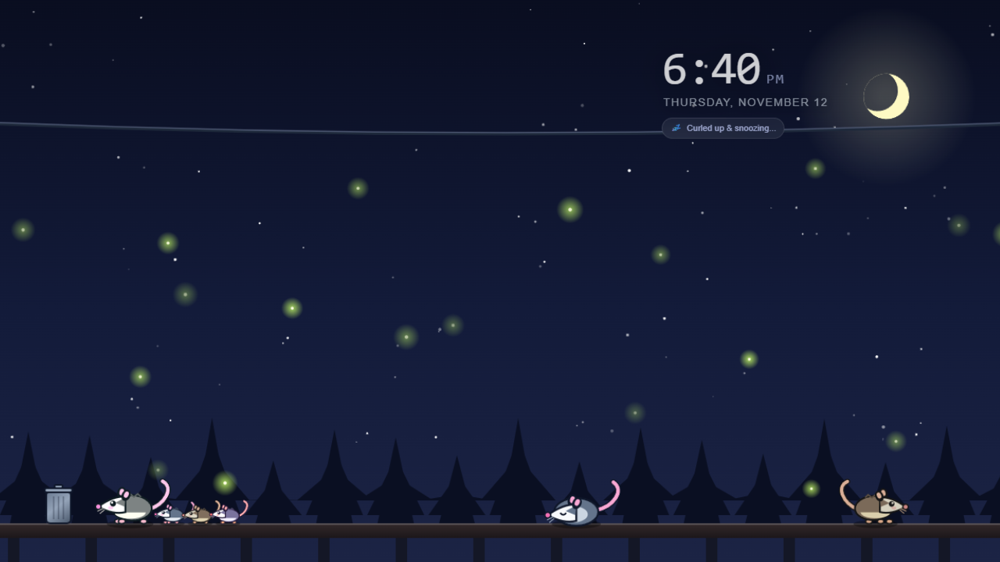
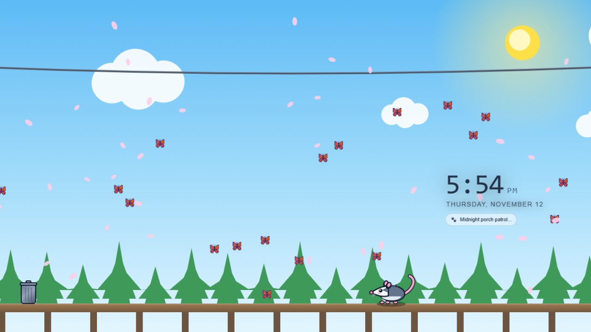
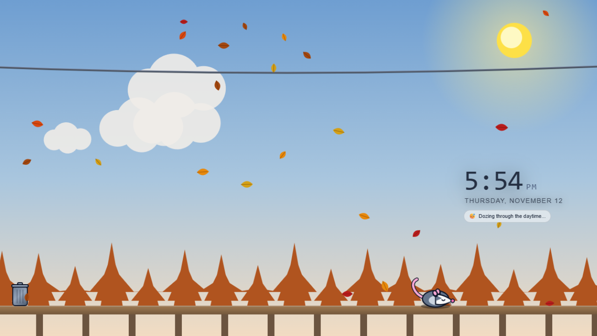

# Possum Operational ScreenSaver (POSS)

A Windows screensaver starring **Barnaby the possum**, a moonlit porch, and a cast of nocturnal troublemakers.
(Inside the app and its files it goes by the name *Pocket Possum*.)
It's a real `.scr` file: install it from Windows' Screen Saver Settings, or run it in the tray and let it start by itself
after a few idle minutes.

| Day | Night, with the whole family |
|---|---|
|  |  |

| Spring | Autumn | Winter |
|---|---|---|
|  |  |  |

## Features

- **Real screensaver.** Runs on every monitor, exits on any mouse or keyboard input, live preview in the Windows dialog.
- **Day and night from your system clock**, with a smooth sunrise/sunset blend. You choose when day and night start.
- **Four seasons** from today's date in your time zone (hemisphere inferred from the zone, or set it yourself):
  spring petals, summer butterflies and bees, autumn leaves, winter snow.
- **A cast of possums after dark.** Barnaby is joined by **Bandit** (chaos agent) and, a little later, **Maple** with her
  three joeys **Pip**, **Nibs** and **Dot**. They chase, hiss, faint, steal snacks, wreck the trash can, swipe the baby
  joey, hitch rides on Maple's back and nap in a pile. It's all random, so no two nights are the same.
- **Burn-in protection.** The clock wanders the screen, the moon travels across the sky and the whole scene drifts slowly.
- **Idle timer built in.** A tray app starts the screensaver after N minutes of no keyboard/mouse activity
  (default 10), and can launch with Windows.
- **Works offline.** The page, CSS and fonts are embedded in a single ~1.5 MB `.scr`.

## Requirements

- Windows 10 or 11 (x64)
- [.NET 10 Desktop Runtime](https://dotnet.microsoft.com/download/dotnet/10.0) (x64)
- WebView2 Runtime (preinstalled on Windows 11 and current Windows 10)

## Install

1. Download `PocketPossum.scr` from the latest build (or build it yourself, see below).
2. Right-click it and choose **Install**. Windows opens Screen Saver Settings with it selected.
   Click **Settings...** to configure it. To install for all users, copy it to `C:\Windows\System32` first.
3. Optional: double-click `PocketPossum.exe` (or the `.scr`) with no arguments to run it in the system tray. It then
   starts the screensaver after your idle time, independently of the Windows timer.

> The file is unsigned, so Windows SmartScreen may warn the first time. Only run builds you trust.

## Settings

Open them from **Settings...** in the Screen Saver dialog, or from the tray icon (right-click, **Settings...**).

| Setting | What it does |
|---|---|
| Scene | Porch (moonlit night), OLED Void (pure black, always night) or Synthwave |
| Clock and date | Show or hide the floating clock |
| Squeak sounds | Soft synthesized squeaks (off by default) |
| Baby joey passenger | Barnaby carries a joey, which Bandit may try to swipe |
| Day / night | Automatic by system time, always day, or always night, plus the hours day and night start |
| Season | Automatic by date, or pin one. Hemisphere: automatic from time zone, or set it |
| Start when idle for N minutes | The tray app launches the screensaver after N idle minutes |
| Run in the tray when Windows starts | Adds a per-user startup entry (no admin needed) |

Settings are stored in `%LOCALAPPDATA%\PocketPossum\settings.json`.

## Command line

| Argument | Behavior |
|---|---|
| *(none)* or `/t` | Run in the tray and start the screensaver after the idle time |
| `/s` | Run the screensaver now (all monitors) |
| `/c` | Settings dialog |
| `/p <hwnd>` | Preview inside the Screen Saver Settings dialog |
| `/w` | Dev: windowed 1280x720 (Esc closes) |
| `/x <file.png>` | Dev: windowed, save a screenshot after 4 s (override with env var `POSSUM_SHOT_DELAY`, in ms), then exit |

Diagnostics, including page script errors and the possums' activity, go to `%LOCALAPPDATA%\PocketPossum\log.txt`.

## Build from source

Requires the [.NET 10 SDK](https://dotnet.microsoft.com/download/dotnet/10.0).

```powershell
dotnet publish -c Release -o dist
```

This produces `dist\PocketPossum.scr` (a renamed `.exe`). A GitHub Actions workflow in `.github/workflows/build.yml`
builds it on every push and uploads it as an artifact.

## Editing the animation

The whole scene is plain HTML, CSS and canvas JavaScript in [`wwwroot/index.html`](wwwroot/index.html). It is embedded in
the executable at build time and served to WebView2 from a virtual host, so there are no external requests.

- Open the file in a browser to preview the original night scene.
  Add `?ss=1&dn=auto&season=auto` to the URL to see the screensaver behavior.
- If you add new Tailwind classes, rebuild the compiled stylesheet (needs Node.js):

  ```powershell
  cd tools/tailwind
  npm install
  npm run css
  ```

- Page URL parameters (set by the host from your settings): `ss`, `theme`, `clock`, `sound`, `joey`,
  `dn` (`auto`/`day`/`night`), `ds`/`ne` (hour day/night starts), `season`, `hemi`.

## Project layout

```text
PocketPossum.csproj        WinForms + WebView2 host (net10.0-windows)
Program.cs                 Argument parsing: /s /c /p /t (and dev modes)
ScreensaverForm.cs         Full-monitor window, input detection
TrayApp.cs, Startup.cs     Idle-timer tray app and "run at login"
ConfigForm.cs, Settings.cs Settings dialog and persistence
PreviewForm.cs             Live preview in the Windows dialog
WebHost.cs                 Serves the embedded site to WebView2
wwwroot/                   index.html, compiled CSS, bundled fonts
tools/tailwind/            Rebuilds wwwroot/app.css
docs/screenshots/          Images used in this README
```

## Credits and licenses

Fonts, Tailwind CSS and WebView2 are used under their own licenses; see
[THIRD_PARTY_NOTICES.md](THIRD_PARTY_NOTICES.md).
