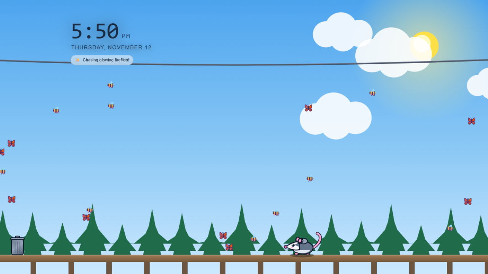
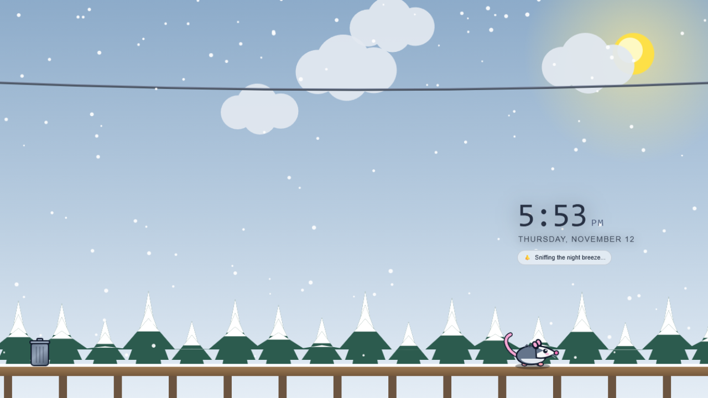
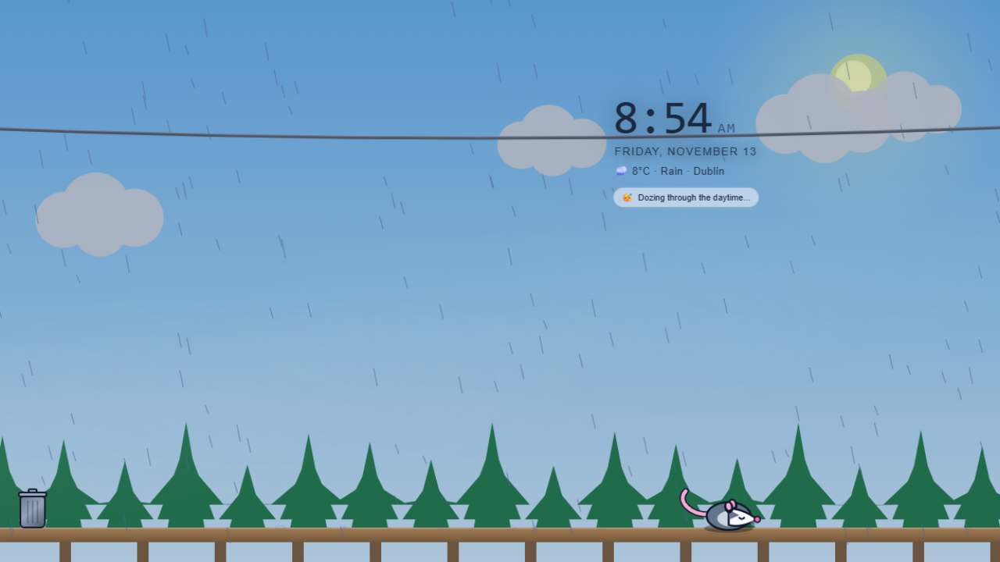
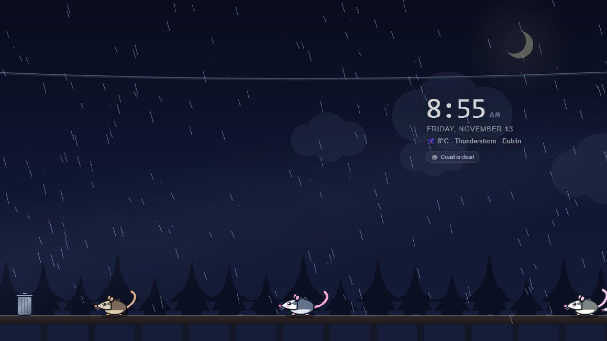
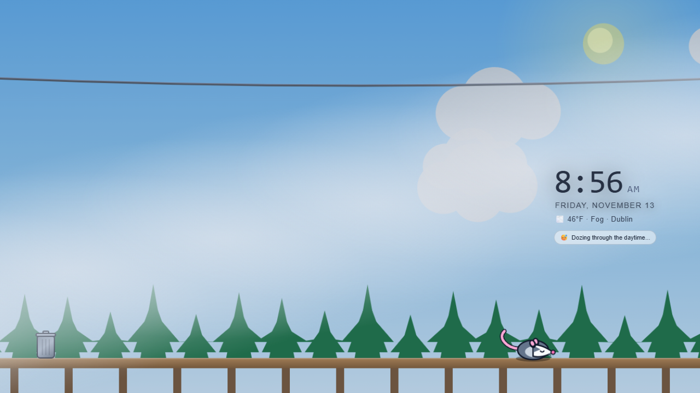
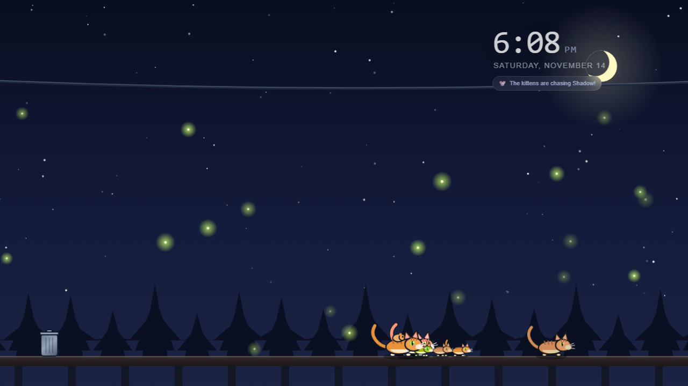
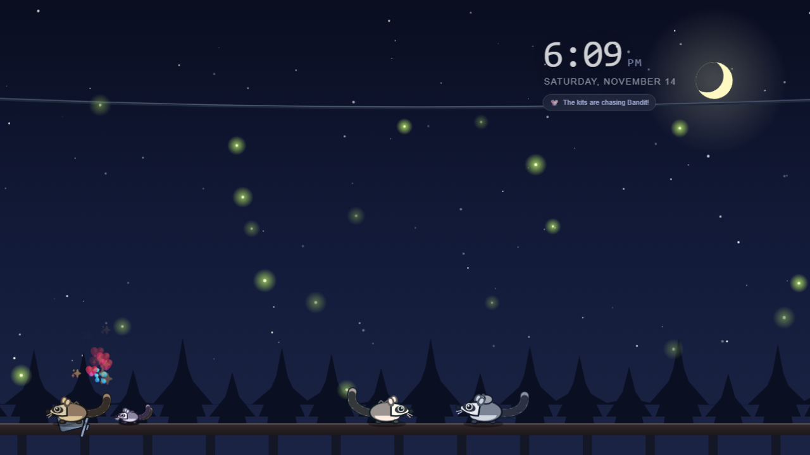
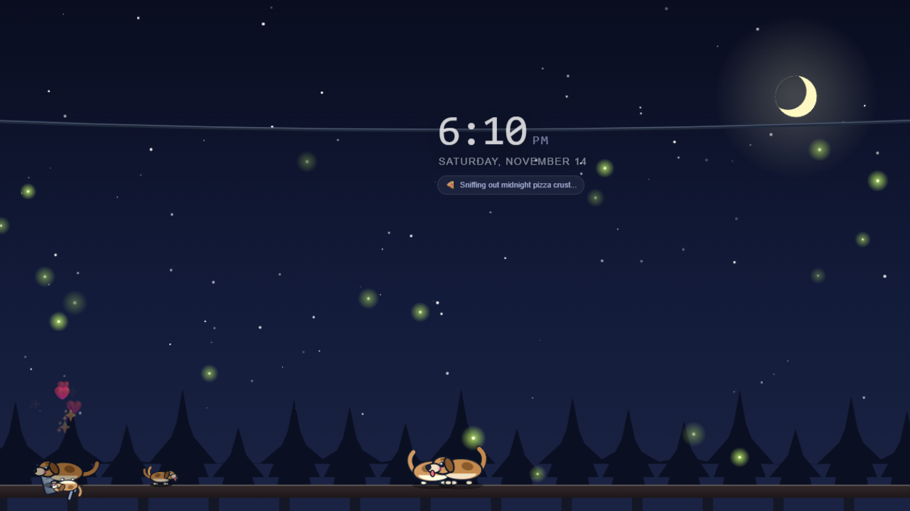
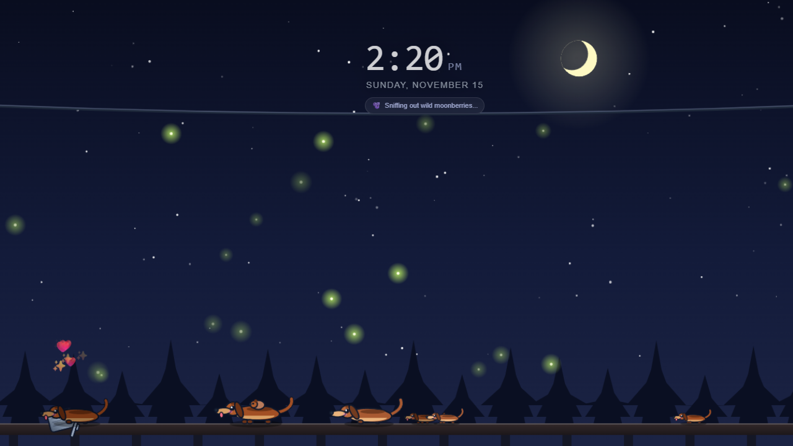
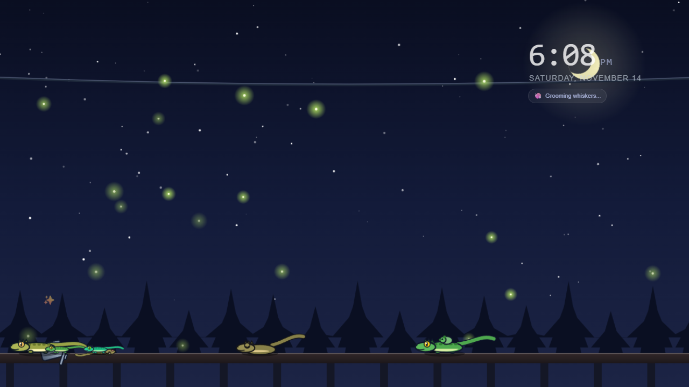

# Possum Operational ScreenSaver (POSS)

A Windows screensaver starring **Barnaby the possum**, a moonlit porch, and a cast of nocturnal troublemakers.
(Inside the app and its files it goes by the name *Pocket Possum*.)

**[Download PocketPossum.scr](https://github.com/TPandaGames/possum-live-wallpaper/releases/latest/download/PocketPossum.scr)**
(v1.5.0) · [Linux .deb](https://github.com/TPandaGames/possum-live-wallpaper/releases/latest/download/pocket-possum_1.5.0_all.deb) · [Zip, if your browser blocks `.scr` files](https://github.com/TPandaGames/possum-live-wallpaper/releases/latest/download/PocketPossum-win-x64.zip)
· [Release notes](https://github.com/TPandaGames/possum-live-wallpaper/releases/latest)
It's a real `.scr` file: install it from Windows' Screen Saver Settings, or run it in the tray and let it start by itself
after a few idle minutes.

| Day | Night, with the whole family |
|---|---|
|  |  |

| Spring | Autumn | Winter |
|---|---|---|
|  |  |  |

| Rain | Thunderstorm | Fog |
|---|---|---|
|  |  |  |

| Cat | Raccoon | Dog |
|---|---|---|
|  |  |  |

| Wiener dog | Lizard |
|---|---|
|  |  |

## Features

- **Choose your animal.** Possum (default), cat, raccoon, dog, wiener dog or lizard, in **Settings > Scene > Animal**. The whole cast
  changes with it, with its own names (for example Biscuit, Shadow and Ginger with kittens Mittens, Socks and Pickle)
  and the same behaviour: patrols, naps, chases, standoffs, snack stealing and family outings.
- **Weather sync (optional).** Pick your city and the scene follows the real weather: cloud cover, rain, snow, fog and
  thunderstorms (with lightning that spooks the possums), plus the temperature under the clock. It also uses your
  location's real sunrise and sunset for day and night. Off by default, see [Weather sync](#weather-sync).
- **Real screensaver.** Runs on every monitor, exits on any mouse or keyboard input, live preview in the Windows dialog.
- **Day and night from your system clock**, with a smooth sunrise/sunset blend. You choose when day and night start.
- **Four seasons** from today's date in your time zone (hemisphere inferred from the zone, or set it yourself):
  spring petals, summer butterflies and bees, autumn leaves, winter snow.
- **A cast of possums after dark.** Barnaby is joined by **Bandit** (chaos agent) and, a little later, **Maple** with her
  three joeys **Pip**, **Nibs** and **Dot**. They chase, hiss, faint, steal snacks, wreck the trash can, swipe the baby
  joey, hitch rides on Maple's back and nap in a pile. It's all random, so no two nights are the same.
- **Burn-in protection.** The clock wanders the screen, the moon travels across the sky and the whole scene drifts slowly.
- **Idle timer built in.** A tray app starts the screensaver after N minutes of no keyboard/mouse activity
  (default 10), and can launch with Windows.
- **Works offline.** The page, CSS and fonts are embedded in a single ~1.5 MB `.scr`.

## Requirements

- Windows 10 or 11 (x64)
- [.NET 10 Desktop Runtime](https://dotnet.microsoft.com/download/dotnet/10.0) (x64)
- WebView2 Runtime (preinstalled on Windows 11 and current Windows 10)

## Install

1. Download [`PocketPossum.scr`](https://github.com/TPandaGames/possum-live-wallpaper/releases/latest/download/PocketPossum.scr)
   from the [latest release](https://github.com/TPandaGames/possum-live-wallpaper/releases/latest)
   (or the [zip](https://github.com/TPandaGames/possum-live-wallpaper/releases/latest/download/PocketPossum-win-x64.zip)
   if your browser blocks `.scr` files), or build it yourself, see below.
2. Right-click it and choose **Install**. Windows opens Screen Saver Settings with it selected.
   Click **Settings...** to configure it. To install for all users, copy it to `C:\Windows\System32` first.
3. Optional: double-click `PocketPossum.exe` (or the `.scr`) with no arguments to run it in the system tray. It then
   starts the screensaver after your idle time, independently of the Windows timer.

> The file is unsigned, so Windows SmartScreen may warn the first time. Only run builds you trust.

## Settings

Open them from **Settings...** in the Screen Saver dialog, or from the tray icon (right-click, **Settings...**).

| Setting | What it does |
|---|---|
| Scene | Porch (moonlit night), OLED Void (pure black, always night) or Synthwave |
| Clock and date | Show or hide the floating clock |
| Squeak sounds | Soft synthesized squeaks (off by default) |
| Baby joey passenger | Barnaby carries a joey, which Bandit may try to swipe |
| Day / night | Automatic by system time, always day, or always night, plus the hours day and night start |
| Season | Automatic by date, or pin one. Hemisphere: automatic from time zone, or set it |
| Weather sync | Follow the real weather for a location you search for (see [Weather sync](#weather-sync)) |
| Temperature | Celsius, Fahrenheit, or automatic by system region |
| Start when idle for N minutes | The tray app launches the screensaver after N idle minutes |
| Run in the tray when Windows starts | Adds a per-user startup entry (no admin needed) |

Settings are stored in `%LOCALAPPDATA%\PocketPossum\settings.json`.

## Weather sync

Open **Settings... > Weather**, tick *Sync the scene with the real weather*, search for your city or town, pick it
from the list and press OK. Then:

- **Clouds** follow the real cloud cover (how many, how dark, how fast the wind moves them), by day and by night.
  The sun, moon and stars dim behind them.
- **Rain** falls slanted by the wind, **snow** falls and settles on the trees and rail (in any season), **fog** rolls in,
  and **thunderstorms** add lightning (and thunder if sounds are on). The possums get startled by the bolts.
- Fireflies and butterflies stay home when it is wet or foggy, and fallen leaves and petals stay down in the rain.
- A small line under the clock shows the conditions and temperature, for example `6°C · Clear · Dublin`.
- **Day and night** use your location's **real sunrise and sunset**, and the **season and hemisphere** come from the
  location. Your hours in *Day / night* are used only when weather sync is off.
- If the connection drops, the last reading is used for up to 3 hours, then the normal scene returns.

**Privacy.** Weather sync is off by default. When it is on, the screensaver sends the coordinates of the location you
chose, over HTTPS, to [Open-Meteo](https://open-meteo.com/) about every 15 minutes (and the city search sends the text
you type to its geocoding service). Nothing else is sent and no account or API key is involved.
Weather data by [Open-Meteo.com](https://open-meteo.com/) under
[CC BY 4.0](https://creativecommons.org/licenses/by/4.0/).

## Live desktop wallpaper

The same scene can run as your **desktop background**, behind the icons and any widgets, on every monitor. Right-click
the tray icon and tick **Live wallpaper** (or tick it under **Settings... > Startup**). Untick it to get your normal
wallpaper back. With "Run in the tray when Windows starts" on, it comes back after every login. It's muted, takes no
mouse or keyboard input, and uses the same weather, day/night and season settings. It **pauses automatically while a
full-screen app or game is in front** (checked every 2 seconds) and resumes when you leave it. Otherwise it uses some
GPU/CPU all the time, so turn it off on battery if that matters to you.

## Linux

A Linux build runs the same scene in a WebKitGTK window. It is packaged as a `.deb` for Debian, Ubuntu and derivatives.

```bash
sudo apt install ./pocket-possum_1.5.0_all.deb     # pulls in Python, GTK3 and WebKit2GTK
pocket-possum --settings                            # or find "Possum Operational ScreenSaver" in your app menu
```

| Command | What it does |
|---|---|
| `pocket-possum --screensaver` | Full-screen on every monitor; any key, click, scroll or mouse movement exits |
| `pocket-possum --wallpaper` | Live desktop background on every monitor (X11 / XWayland only) |
| `pocket-possum --watch` | Idle watcher: starts the screensaver after the idle time and manages the wallpaper |
| `pocket-possum --window` | A normal window |
| `pocket-possum --settings` | Settings dialog (same options as Windows, in `~/.config/PocketPossum/settings.json`) |

Build the package yourself with `linux/build-deb.sh` (it only needs `dpkg-deb`). Install `xprintidle` for the idle
watcher. Settings, weather sync, animals, seasons and the possum family work exactly as on Windows.

Things that differ from Windows:

- **No tray icon.** The idle watcher runs in the background; start it with `pocket-possum --watch` or tick
  *Run the idle watcher when I log in* in Settings.
- **X11 only for the wallpaper and idle watcher.** Wayland desktops don't allow a window behind the desktop, and idle
  time isn't available to ordinary apps. On Wayland, point your desktop's idle or lock settings at
  `pocket-possum --screensaver`.
- The wallpaper does **not** pause for full-screen apps on Linux yet.

Tested on Debian 13 (trixie) under WSL2 with a virtual X server and the Openbox window manager: install, upgrade and
removal, `lintian` clean, the screensaver (idle, and exit on mouse, key and click), the wallpaper window type,
the idle watcher, the settings dialog and live weather. **Not tested:** multiple monitors, real GNOME/KDE/Xfce desktops,
native Wayland, and other distributions.

## Command line (Windows)

| Argument | Behavior |
|---|---|
| *(none)* or `/t` | Run in the tray and start the screensaver after the idle time |
| `/s` | Run the screensaver now (all monitors) |
| `/c` | Settings dialog |
| `/b` | Run as the live desktop wallpaper (normally started by the tray app) |
| `/p <hwnd>` | Preview inside the Screen Saver Settings dialog |
| `/w` | Dev: windowed 1280x720 (Esc closes) |
| `/x <file.png>` | Dev: windowed, save a screenshot after 4 s (override with env var `POSSUM_SHOT_DELAY`, in ms), then exit |

Diagnostics, including page script errors and the possums' activity, go to `%LOCALAPPDATA%\PocketPossum\log.txt`.

## Build from source

Requires the [.NET 10 SDK](https://dotnet.microsoft.com/download/dotnet/10.0).

```powershell
dotnet publish -c Release -o dist
```

This produces `dist\PocketPossum.scr` (a renamed `.exe`). A GitHub Actions workflow in `.github/workflows/build.yml`
builds it on every push and uploads it as an artifact.

## Build the installer

The setup wizard is an [Inno Setup](https://jrsoftware.org/isinfo.php) script in
[`installer/PocketPossum.iss`](installer/PocketPossum.iss). With Inno Setup 6 installed:

```powershell
dotnet publish -c Release -o dist
iscc installer\PocketPossum.iss
```

This writes `installer\Output\PocketPossum-Setup-<version>.exe`. The installer asks for admin rights (the `.scr` is
copied to `System32` so it appears in the Screen Saver list), installs the tray app and Start menu shortcuts, and
downloads the .NET 10 Desktop Runtime and WebView2 Runtime from Microsoft if they are missing. It supports
`/VERYSILENT` for unattended installs and removes everything cleanly on uninstall.

## Editing the animation

The whole scene is plain HTML, CSS and canvas JavaScript in [`wwwroot/index.html`](wwwroot/index.html). It is embedded in
the executable at build time and served to WebView2 from a virtual host, so there are no external requests.

- Open the file in a browser to preview the original night scene.
  Add `?ss=1&dn=auto&season=auto` to the URL to see the screensaver behavior.
- If you add new Tailwind classes, rebuild the compiled stylesheet (needs Node.js):

  ```powershell
  cd tools/tailwind
  npm install
  npm run css
  ```

- Page URL parameters (set by the host from your settings): `ss`, `theme`, `clock`, `sound`, `joey`,
  `dn` (`auto`/`day`/`night`), `ds`/`ne` (hour day/night starts), `season`, `hemi`, and for weather
  `wx=1`, `lat`, `lon`, `place`, `unit` (`auto`/`c`/`f`). To fake a reading while developing, add
  `wxtest=<WMO code>` (for example `95` for a thunderstorm) with optional `wxcloud=<0-100>` and `wxwind=<km/h>`.
  The host also appends the environment variable `POSSUM_URL_EXTRA` to the page URL, which is handy with `/x`.

## Project layout

```text
PocketPossum.csproj        WinForms + WebView2 host (net10.0-windows)
Program.cs                 Argument parsing: /s /c /p /t (and dev modes)
ScreensaverForm.cs         Full-monitor window, input detection
TrayApp.cs, Startup.cs     Idle-timer tray app and "run at login"
ConfigForm.cs, Settings.cs Settings dialog and persistence
PreviewForm.cs             Live preview in the Windows dialog
WebHost.cs                 Serves the embedded site to WebView2
wwwroot/                   index.html, compiled CSS, bundled fonts
tools/tailwind/            Rebuilds wwwroot/app.css
docs/screenshots/          Images used in this README
linux/                     Linux version: GTK/WebKit app, .deb build script, man page
```

## Credits and licenses

Fonts, Tailwind CSS and WebView2 are used under their own licenses; see
[THIRD_PARTY_NOTICES.md](THIRD_PARTY_NOTICES.md).
